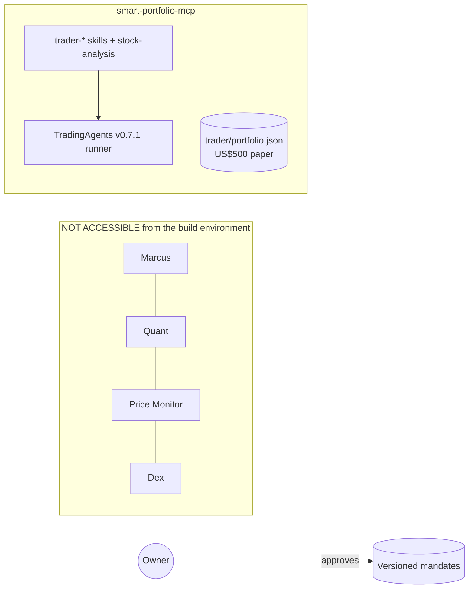
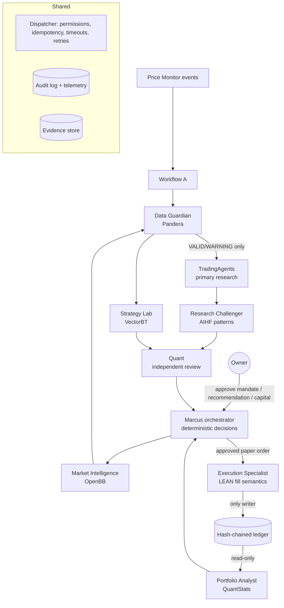

# Marcus V2 — Architecture

## Current (verified in this build)

## Target (implemented in `marcus_v2/`)

Every specialist call goes through the dispatcher (`core/orchestration.py`), which checks the
permission policy (`core/permissions.py`), enforces idempotency for state-changing tools, applies
timeouts and bounded retries, and writes one `AgentExecutionLog` per call.

## Agent responsibility matrix

| Agent | Decides | Computes | Writes | Must not |
|---|---|---|---|---|
| Marcus | BUY/WAIT/HOLD/REDUCE/EXIT proposal, sizing within mandate | — (delegates) | recommendations, incidents | approve its own recommendations, trade |
| Market Intelligence | — | retrieval, trend context | MI reports, cache | recommend, trade |
| Data Guardian | VALID / WARNING / REJECTED (deterministic) | schema + rule checks | DQ reports | override rejections, repair prices |
| Strategy Lab | — | backtests, sensitivity, leakage checks | backtest results | deploy, approve risk controls |
| Research Challenger | — | contradictions, missing evidence, downside | challenge reports | allocate, trade, invent evidence |
| Execution Specialist | eligibility (deterministic) | fills, costs | **ledger** (only writer), fill records | live trading, price substitution |
| Portfolio Analyst | — | equity, TWR, risk, reconciliation | analysis reports | write ledger, approve allocations |
| TradingAgents (existing) | rating + thesis | LLM research | research reports | — |
| Quant (existing) | SUPPORTED / CHALLENGED | independent review | quant reviews | — |
| Owner | mandate, capital, approvals, deployment | — | approvals | — |

## Tool and dependency matrix

| Agent | Tools | Library (pinned) | Network | LLM |
|---|---|---|---|---|
| Market Intelligence | get_instrument_metadata, get_historical_prices, get_market_snapshot, get_market_context, compare_data_providers, check_data_availability, get_macro_indicators | openbb-core 2.0.1, openbb-yfinance 2.1.0 | query1/query2.finance.yahoo.com | no |
| Data Guardian | validate_report, validate_observations, compare_provider_observations, generate_data_quality_report, explain_exceptions | pandera 0.36.0 | none | explanations only |
| Strategy Lab | run_strategy_backtest, run_fee_sensitivity, run_slippage_sensitivity, test_parameter_robustness, run_walk_forward_validation | vectorbt 1.2.0, numba 0.68.1 | none | no |
| Research Challenger | review_investment_thesis, identify_unsupported_claims, analyse_downside_scenarios, identify_missing_evidence | — (patterns from ai-hedge-fund 5c553b5) | LLM API if configured | counter-arguments only |
| Execution Specialist | simulate_execution, check_available_cash, estimate_transaction_cost, check_order_status, reconcile_paper_fill, explain_execution_exception | LEAN 3afb212 semantics (no runtime dep); optional Docker image | none | explanations only |
| Portfolio Analyst | generate_performance_report, reconcile_cash_flows, calculate_portfolio_equity, detect_performance_anomalies | quantstats 0.0.86 | none | no |

## Contracts

All in `marcus_v2/core/contracts.py` (schema version 1.0): InvestmentMandate, Instrument,
MarketObservation, MarketEvent, DataQualityReport, MarketIntelligenceReport, ResearchReport,
ResearchChallengeReport, BacktestRequest, BacktestResult, QuantReview, PortfolioSnapshot,
InvestmentRecommendation, PaperOrder, PaperFill, LedgerEvent, PortfolioAnalysisReport,
AgentExecutionLog. `paper` / `paper_only` fields are `Literal[True]`: they cannot be set otherwise.

## Workflows

- **A — monitoring:** Price Monitor events → de-duplicated (persistent seen-event set) → Data
  Guardian on fresh bars → material events flagged for research refresh. No research per alert.
- **B — new opportunity:** MI context → DG (`decision`) → TradingAgents → Research Challenger →
  Strategy Lab (if a rule-based strategy is supplied) → Quant (independent; receives evidence,
  not Marcus's verdict) → deterministic decision (trend filter, contradictions, Quant verdict,
  plan present) → sizing = floor(max-loss-per-trade ÷ (entry − stop)), capped by position limit
  → recommendation **pending owner approval**. Disagreements are listed, never averaged.
- **C — portfolio review:** Portfolio Analyst → concentration vs mandate → REDUCE proposals
  pending approval.
- **D — outage:** rejected data or unavailable research → recommendation `blocked`, new entries
  refused, limitations disclosed, incident file for Dex. No substitute data, no new strategy.

## Storage (all under `MARCUS_V2_HOME`, default `var/marcus_v2`, git-ignored)

`ledger/<portfolio>.jsonl` (hash chain), `mandates/`, `evidence/`, `audit/agent_executions.jsonl`,
`audit/events.jsonl`, `fills/`, `incidents/`, `quant/inbox|outbox`, `cache/`, `llm_cache/`.
Plain files: no database or always-on service needed on the Mac mini.
